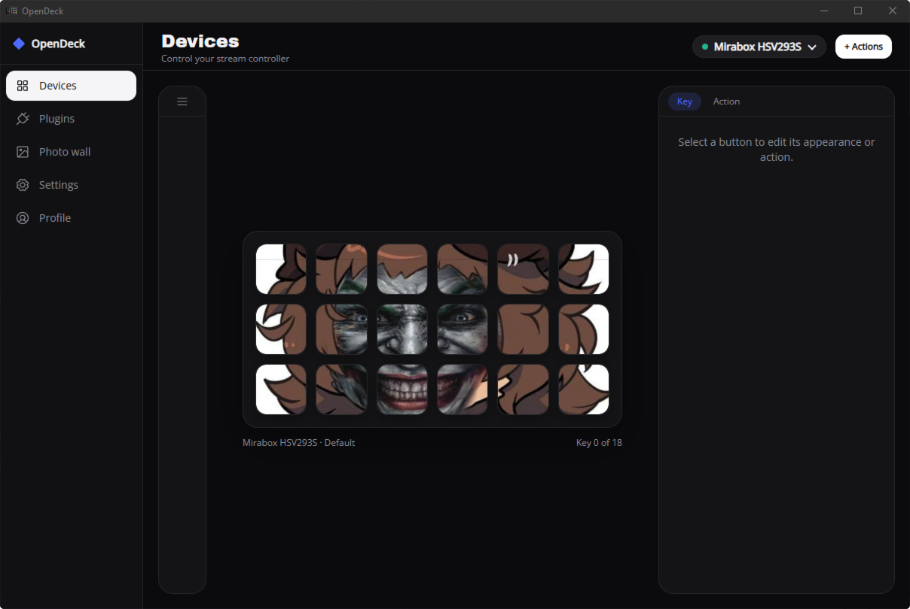
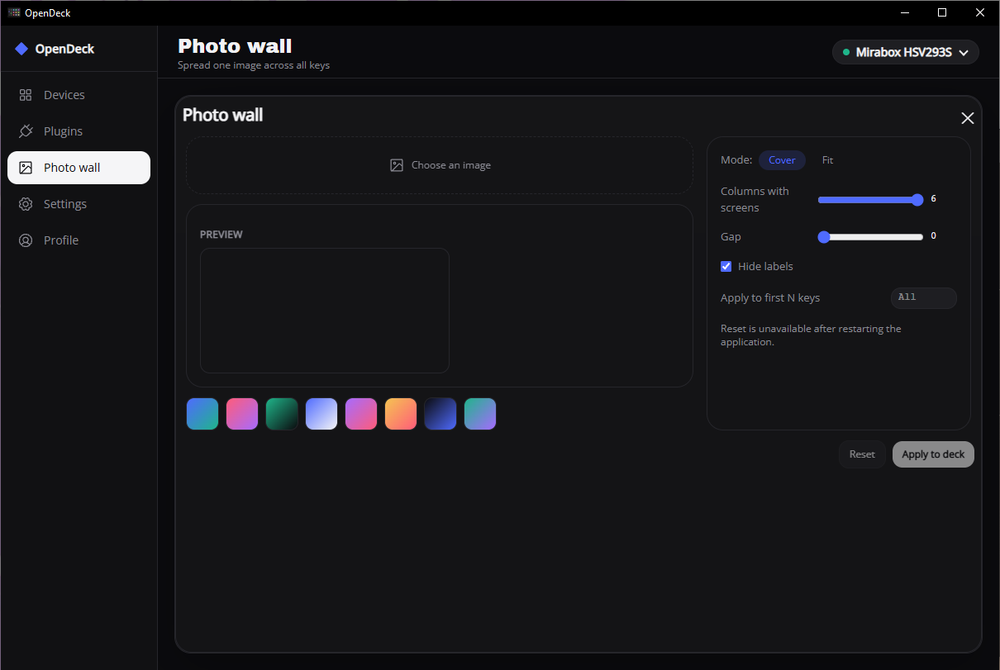
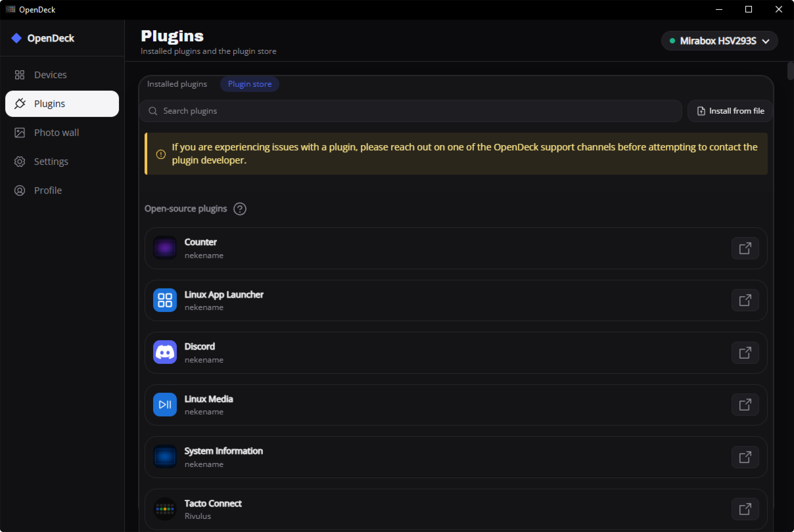
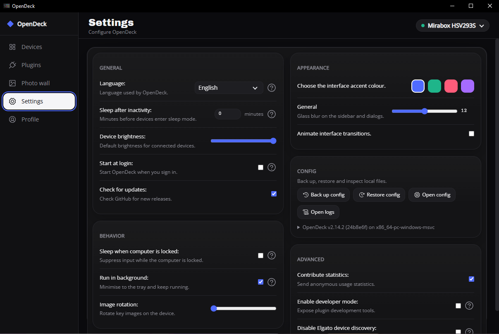

# OpenDeck (fork)

A fork of [OpenDeck](https://github.com/nekename/OpenDeck) by nekename: desktop software for Stream Deck-style devices, with a redesigned interface, a **Photo wall** feature, automatic config backups and a plugin watchdog.

> [!NOTE]
> This is an unofficial fork. It is not affiliated with Elgato, Mirabox or the original OpenDeck project. Bugs in the base functionality can also be reported to the [original repository](https://github.com/nekename/OpenDeck/issues); bugs in the features listed below belong in this fork's issues.

<!-- Replace with your own screenshots, for example in .github/readme/ -->





## What is different from upstream

| Feature | Description |
| --- | --- |
| **Photo wall** | Pick one image and spread it across all keys of the device, like one big photo. |
| **New interface** | Full redesign: sidebar navigation, Devices, Plugins, Photo wall, Settings and Profile pages, accent color and glass blur options. |
| **Plugin watchdog** | A crashed plugin is restarted automatically. Per-plugin status and an Auto-restart toggle. |
| **Automatic config backup** | A zip backup of your configuration is created on startup, and the latest 10 are kept. |

Everything else (Stream Deck SDK and OpenAction plugin support, Multi Actions, Toggle Actions, profile switching, brightness control) comes from upstream OpenDeck.

## Supported devices

Elgato hardware is supported by upstream OpenDeck. Other hardware works through plugins.

This fork was developed and tested with a **Mirabox HSV293S** (6 columns x 3 rows, screens on the first 5 columns) using the *Ajazz AKP153 / Mirabox HSV293S* plugin. Other devices that work with upstream OpenDeck should keep working, but only the 293S has been tested.

## Photo wall

Photo wall cuts one picture into tiles, one per key, and applies each tile as a custom image.

1. Open the **Photo wall** page.
2. Choose an image, or click one of the gradient presets.
3. Pick a mode:
   - **Cover** fills the whole grid and crops the overflow.
   - **Fit** keeps the whole image and fills the rest with a background color.
4. Set **Columns with screens**. Some devices have keys without screens (the 293S has 6 columns but screens only on 5). Set this to the number of columns that have screens so no part of the image is lost.
5. Adjust **Gap** to match the physical bezel between the screens so the picture lines up across keys.
6. Optionally keep **Hide labels** on so action text is not drawn over the photo.
7. Press **Apply to deck**. Tiles are sent one by one with a short delay, with progress and a cancel option.

Notes:

- Empty keys get a built-in no-op tile action so they can show part of the photo. It does nothing when pressed and is hidden from the action list.
- **Reset** restores the previous keys, but only until the application is restarted. After a restart the old state is gone, so back up your config before the first use (see below).
- Tiles are sent as JPEG. Large images are resized to the key resolution before sending.
- "Apply to first N keys" is useful for a quick test on one or two keys.

## Plugin watchdog

- Native, Node.js and Wine plugins are monitored. Webview plugins are not.
- If a plugin process exits unexpectedly, it is restarted with increasing pauses (1, 2, 4, 8, 16 seconds), up to 5 attempts.
- A plugin must stay up for 60 seconds before the attempt counter resets.
- After 5 failed attempts the status becomes **Failed** and no more automatic restarts happen. The exit code is shown and written to the plugin log.
- The **Restart** button restarts a plugin manually and resets the counter.
- Disabling, removing or restarting a plugin yourself, and closing the app, never trigger the watchdog.
- **Auto-restart** can be switched off per plugin. The setting is stored in `watchdog.json` in the config folder.

## Automatic backups

On every start the app saves a zip of your configuration (profiles, images, settings and user plugins) into the `backups` folder inside the config directory, and keeps the 10 most recent copies. Logs, temporary files and built-in plugins are not included. A failed backup never prevents the app from starting.

You can also use **Back up config** and **Restore config** on the Settings page.

Config folder on Windows: `%appdata%\opendeck\`
Logs: `%appdata%\opendeck\logs\`

## Installation

Download the installer (`.exe` or `.msi`) from the [Releases page](https://github.com/Nucoka/OpenDeck/releases).

> [!WARNING]
> The installer is not code-signed, so Windows SmartScreen may show an "unknown publisher" warning. Click **More info**, then **Run anyway**.

Before the first run, close the original OpenDeck if it is installed: two instances cannot control the same device. If you already use OpenDeck, copy `%appdata%\opendeck` somewhere safe first.

Only Windows has been tested. Linux and macOS builds should be possible from source, as with upstream, but are untested in this fork.

## Building from source

Prerequisites:

- [Tauri prerequisites](https://tauri.app/start/prerequisites) (on Windows: Microsoft C++ Build Tools with "Desktop development with C++", and WebView2)
- [Rust](https://rustup.rs/)
- [Deno](https://deno.com/)
- Git

```bash
git clone https://github.com/Nucoka/OpenDeck
cd OpenDeck
deno install
deno task tauri dev      # development mode
deno task tauri build    # release build, output in src-tauri/target/release/bundle
```

The first Rust build takes a while.

If `cargo` fails with "access denied" on `opendeck.exe`, an old instance is still running. Close it (including the tray icon) or run `taskkill /F /IM opendeck.exe`.

Before committing, run `cargo clippy`, `cargo fmt`, `deno task check` and `deno task format`, as in upstream. [AGENTS.md](AGENTS.md) describes the codebase structure, including the files added by this fork:

- `src/lib/photoWall.ts` and `src/components/PhotoWall.svelte`: image slicing and the Photo wall page
- `photo_wall_apply_tile` command and the `opendeck.photowalltile` built-in action
- `src-tauri/src/backup.rs`: startup backups
- `src-tauri/src/plugins/watchdog.rs`: plugin watchdog

## Troubleshooting

- Your device does not appear: make sure the matching plugin for your hardware is installed and running (Plugins page), and restart OpenDeck after connecting the device.
- Check the logs in `%appdata%\opendeck\logs\` (also available via **Open logs** in Settings). Include them when reporting an issue.
- A plugin keeps crashing: look at its status and exit code on the Plugins page and at its log file in the logs folder.
- Photo wall pieces do not line up with the screens: adjust **Gap** and **Columns with screens**, then apply again.
- General questions and base-feature problems: see the upstream [FAQ](https://github.com/nekename/OpenDeck/wiki/0.-FAQ) and [issues](https://github.com/nekename/OpenDeck/issues).

## Known limitations

- Photo wall **Reset** works only until the app is restarted.
- Sending images to some devices is slow, so applying to all keys takes a few seconds.
- Only the Mirabox HSV293S and Windows have been tested.

## Credits and license

This project is a fork of [OpenDeck](https://github.com/nekename/OpenDeck) by [nekename](https://github.com/nekename). Many thanks to the author and to the developers of [Tauri](https://github.com/tauri-apps/tauri), the [elgato-streamdeck](https://github.com/OpenActionAPI/rust-elgato-streamdeck) library, and [Phosphor Icons](https://phosphoricons.com/). If you like OpenDeck itself, consider supporting the original author.

Licensed under the GNU General Public License version 3.0 or later, the same as upstream. See [LICENSE.md](LICENSE.md). This fork modifies the original source code; all changes are available in this repository's history.
